<div align="center">

# PotroPath

**Ya elegiste Computación. Ahora encuentra tu camino.**

Diagnóstico de afinidad vocacional *dentro* de Ingeniería en Computación,
para estudiantes de la Facultad de Ingeniería de la UAEMéx.

50 afirmaciones · 5 especialidades · sin registro · sin datos personales

</div>

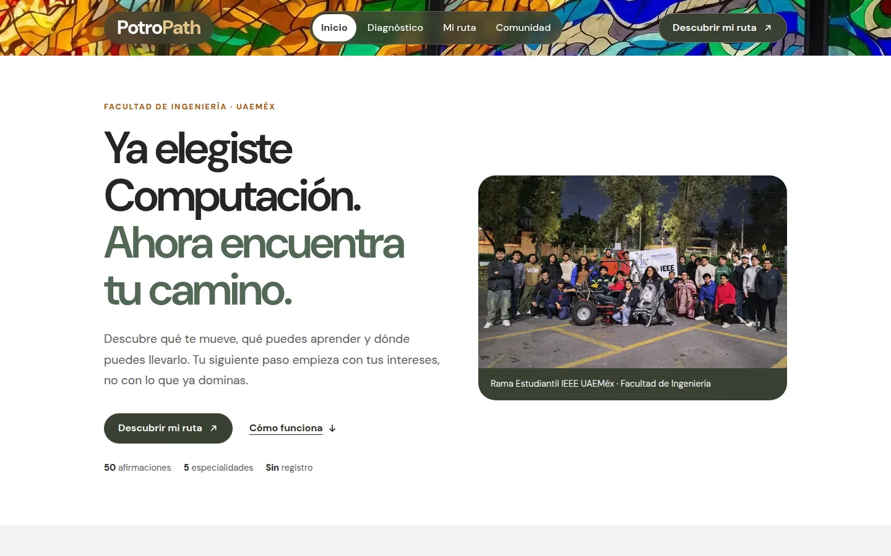

**Contenido:** [Qué es](#qué-es) · [Cómo se usa](#cómo-se-usa) · [Qué sale de tu navegador](#qué-sale-de-tu-navegador) · [Correrlo en tu equipo](#correrlo-en-tu-equipo) · [Memoria descriptiva](#memoria-descriptiva) · [Referencia técnica](#referencia-técnica) · [Estado del proyecto](#estado-del-proyecto)

---

## Qué es

Un test vocacional te ayuda a elegir carrera. PotroPath empieza donde ese test termina: da por hecho que ya estudias Ingeniería en Computación y responde la pregunta siguiente — cuál de sus especializaciones es la tuya, y qué pide hoy la industria para ella.

Respondes 50 afirmaciones sobre lo que disfrutas —no sobre lo que ya dominas— y PotroPath mide tu afinidad con cinco áreas: **Inteligencia Artificial**, **Ciberseguridad**, **Cloud Computing**, **Ciencia de Datos** y **Desarrollo de Software**. El resultado no se queda en una etiqueta:

- **Tu afinidad en las cinco áreas**, no sólo la ganadora. Un empate se nombra como empate, y si respondes «Neutral» a todo, el sitio no inventa un ganador.
- **Un primer paso para esta semana:** la primera habilidad que aprender, un entregable para practicarla y la comunidad con quien compartirlo.
- **La ruta completa de cualquier área:** cinco habilidades en tres etapas, dos credenciales comparables y un perfil profesional publicado por una empresa tecnológica, cada uno con su fuente oficial y la fecha en que se revisó.
- **Tu comunidad dentro de la facultad:** un canal de Microsoft Teams por especialidad, al que se entra con la cuenta institucional, y los capítulos de la Rama Estudiantil IEEE UAEMéx.

## Cómo se usa

> Las capturas son del sitio real, tomadas del build de producción con un perfil de respuestas de ejemplo inclinado a Ciberseguridad. No corresponden a ningún estudiante.

### 1. Responde el diagnóstico

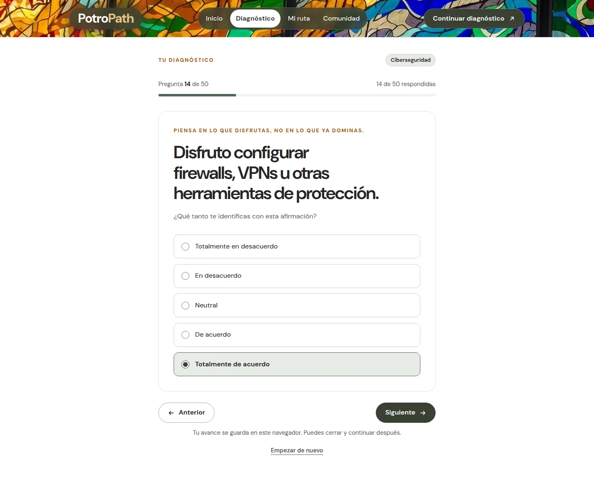

Una afirmación por pantalla, en una escala de «Totalmente en desacuerdo» a «Totalmente de acuerdo». Son diez por área, cincuenta en total, y la barra de arriba dice cuántas llevas. No hay respuestas correctas: piensa en lo que disfrutas, no en lo que ya sabes hacer.

Tu avance se guarda en el navegador, así que puedes cerrar la pestaña entre clases y seguir después donde te quedaste. Con teclado, <kbd>1</kbd>–<kbd>5</kbd> responden y <kbd>Enter</kbd> avanza.

### 2. Lee tu resultado

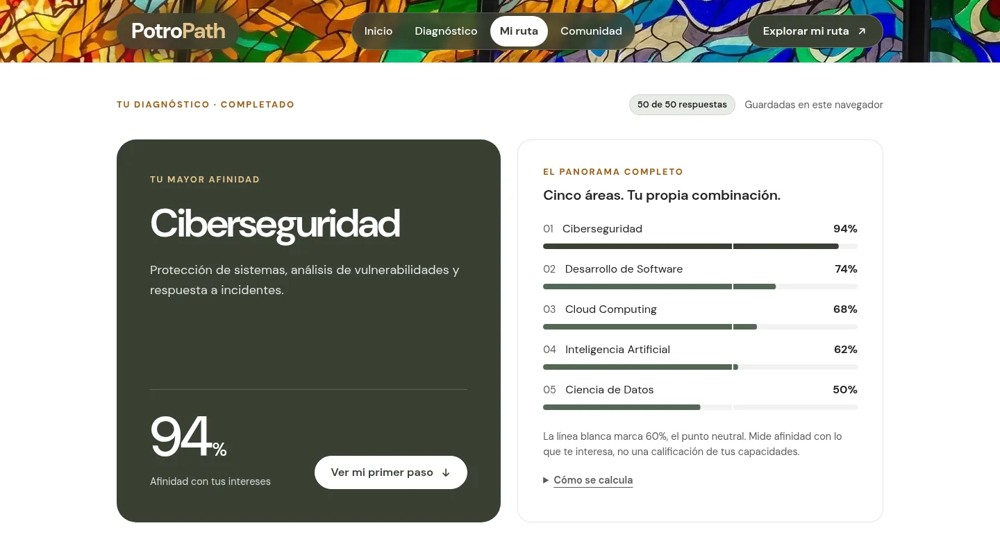

A la izquierda, el área con más afinidad; a la derecha, las cinco con su porcentaje. Cada área suma sus diez respuestas sobre un máximo de 50 puntos, así que la escala va de 20% a 100%, y la línea blanca marca 60%, el punto neutral. Los porcentajes no suman 100: miden afinidad con lo que te interesa, no tu nivel ni tu probabilidad de conseguir empleo.

### 3. Afina tu ruta (opcional)

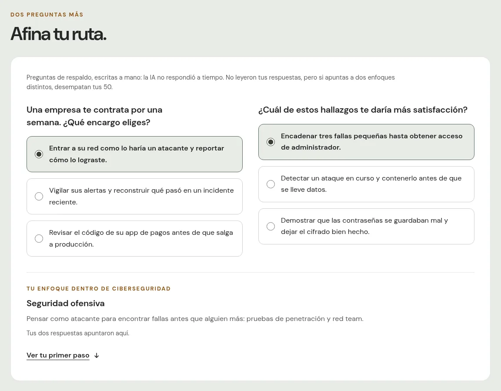

Cada área se divide en tres enfoques; en Ciberseguridad, por ejemplo, seguridad ofensiva, defensa y respuesta, o AppSec y criptografía. Si pulsas **«Afinar mi ruta»**, dos preguntas más eligen el tuyo.

Las redacta Qwen, un modelo de IA de Alibaba que corre en Cerebras, a partir de tus 50 respuestas numéricas, y cambian en cada intento. Lo que no cambia es el catálogo: cada opción está atada a uno de quince enfoques escritos y revisados por personas, y la cuenta que elige el enfoque es determinista. La IA redacta las preguntas; no decide tu ruta. Si el modelo no responde en 8 segundos, entran dos preguntas escritas a mano y la interfaz lo dice — es lo que muestra esta captura.

### 4. Da tu primer paso

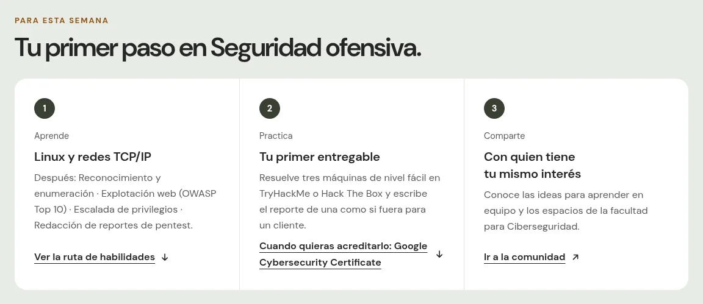

Tres acciones para esta semana: qué aprender, qué entregable hacer para practicarlo y con quién compartirlo. Si afinaste tu ruta, salen de tu enfoque; si no, del área completa.

### 5. Explora la ruta completa

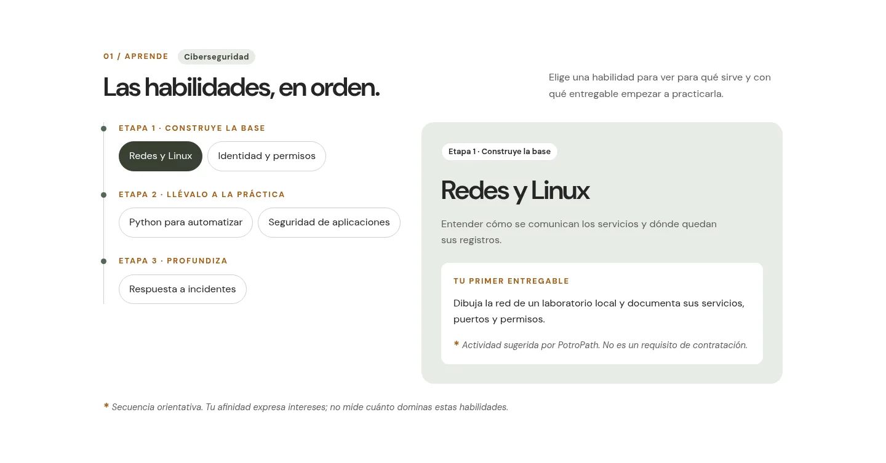

Debajo está la ruta del área en cuatro partes:

| Parte | Qué encuentras |
| --- | --- |
| **Aprende** | Cinco habilidades en tres etapas, cada una con para qué sirve y un primer entregable |
| **Acredita** | Dos credenciales comparables lado a lado: tipo, nivel, preparación y enfoque, con enlace al programa oficial |
| **Conoce el rol** | Un perfil profesional publicado por una empresa tecnológica, con requisitos mínimos y deseables separados |
| **Busca** | Una búsqueda de puestos similares en LinkedIn, con el puesto y la ubicación que tú eliges |

La barra fija de arriba te deja cambiar a cualquiera de las cinco áreas sin tocar tus respuestas: tu resultado ordena la ruta, no te encierra en ella.

<details>
<summary><strong>Ver las credenciales y el perfil profesional</strong></summary>

<br>

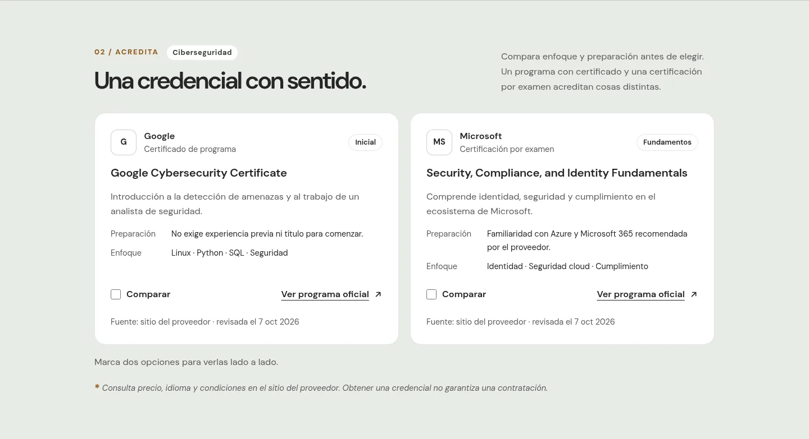

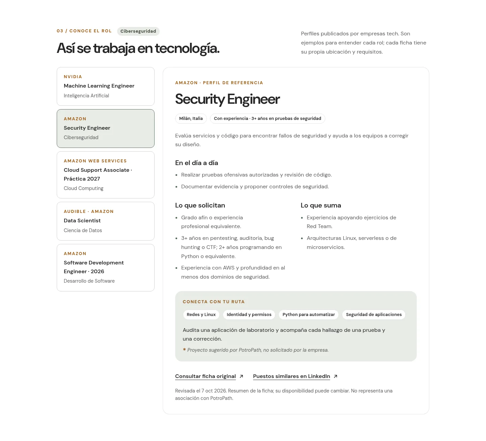

</details>

### 6. Encuentra con quién avanzar

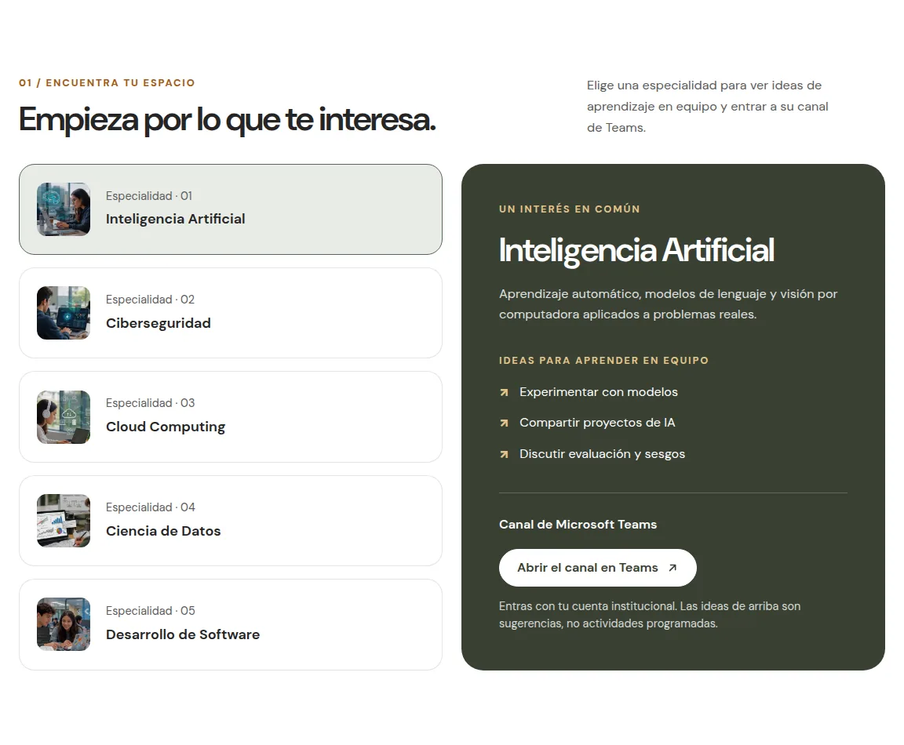

En **Comunidad** eliges una especialidad y entras a su canal de Microsoft Teams con tu cuenta institucional: compartes el espacio con compañeros de tu propia facultad, no con desconocidos.

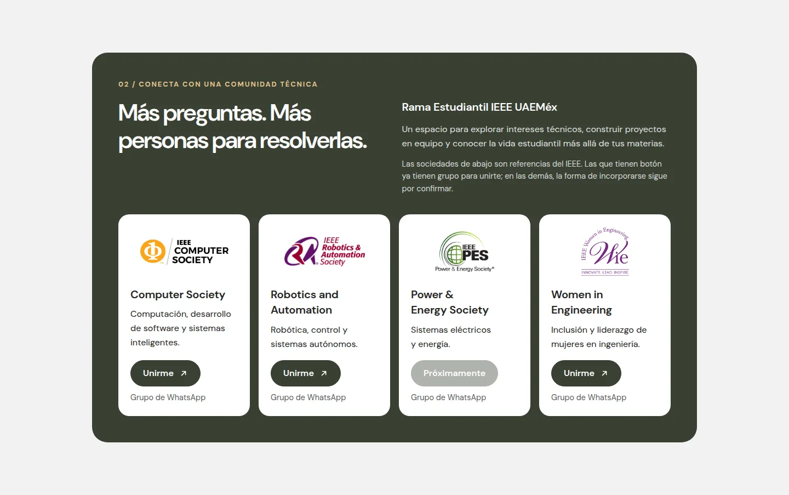

También están los capítulos de la Rama Estudiantil IEEE UAEMéx —tres ya tienen grupo para unirte; el cuarto se marca como «Próximamente»— y una galería de experiencias de estudiantes de la facultad fuera del salón.

### En el teléfono

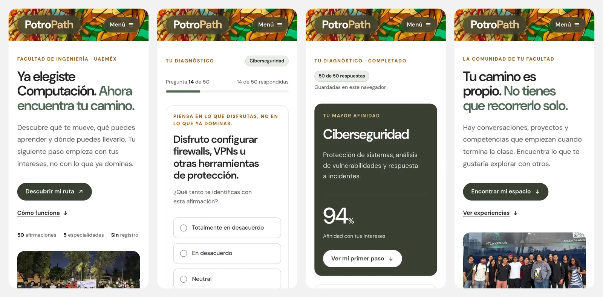

Abrirlo en el teléfono, en un rato libre entre clases y con la red del campus, es uno de los usos principales, así que el recorrido completo funciona igual a 390 px de ancho.

## Qué sale de tu navegador

No hay cuentas, ni correo, ni base de datos. Tus respuestas se guardan sólo en tu navegador (`localStorage`) y salen únicamente en dos casos que tú disparas:

| Cuándo | Qué se envía | A dónde |
| --- | --- | --- |
| Pulsas «Afinar mi ruta» | Las 50 respuestas numéricas, del 1 al 5. Nada que te identifique | La función `/api/detonadoras`, que se las pasa a Qwen en Cerebras y no las escribe en ningún log |
| Buscas puestos similares | El puesto y la ubicación que escribes en el formulario | LinkedIn |

El aviso de qué se envía está escrito encima del botón de afinar, antes de pulsarlo. Para borrar tus respuestas: «Empezar de nuevo» en el diagnóstico o «Repetir diagnóstico» en tus resultados.

## Correrlo en tu equipo

Necesitas [Node.js](https://nodejs.org/) `^20.19.0` o `>=22.12.0` (trae npm). No hay base de datos ni servicio que levantar:

```bash
git clone https://github.com/RogelioZu/PotroHub.git
cd PotroHub
npm ci
npm run dev       # http://localhost:5173
```

Con eso corre el sitio completo. Como Vite no sirve la función de `/api`, «Afinar mi ruta» usa ahí las preguntas de respaldo, que es exactamente lo que pasa en producción cuando el modelo no responde. Para probar el afinado con Qwen, el build de producción, los comandos y la verificación de un cambio, ve a [Puesta en marcha detallada](#puesta-en-marcha-detallada).

---

## Memoria descriptiva

### Datos generales

| Campo              | Valor                                             |
| ------------------ | -------------------------------------------------- |
| Categoría           | Educación y aprendizaje                            |
| Tema                | Recursos Didácticos                                |
| Espacio académico   | Facultad de Ingeniería                             |
| Tipo de solución    | Software / Plataforma Web                          |
| Despliegue          | Local o en la nube, totalmente navegable           |

#### Entregable fase 1

Valoración técnica y presentación de propuesta. Esta etapa inicial se gestiona de forma remota a través del portal de inscripción y representa el 50% de la ponderación global. Es imperativo que los integrantes suban documentación nítida, íntegra y sustentable.

### 1. Planteamiento

El contexto actual en la Facultad de Ingeniería de la UAEMéx refleja un área de oportunidad: los estudiantes de Ingeniería en Computación cursan el plan de estudios con una participación mínima en actividades extracurriculares (hackathones, proyectos independientes, cursos, networking). Esto genera una brecha de habilidades frente a la industria tecnológica, resultando en perfiles de egreso poco atractivos para un mercado laboral altamente competitivo.

- **Usuarios directos:** Estudiantes de Ingeniería en Computación de la UAEMéx (particularmente de semestres iniciales e intermedios).
- **Beneficiarios indirectos:** La Facultad de Ingeniería (mejora en indicadores de calidad de egreso y titulación) y empresas tecnológicas de la región que buscan talento especializado.

> **Nota:** insertar aquí la estadística exacta de titulación de la UAEMéx para dar mayor peso institucional al planteamiento.

### 2. Alcance

PotroPath se presentará como un Producto Mínimo Viable (MVP) sin fricción de entrada (sin sistema de registro de usuarios), enfocado en la entrega de valor inmediato. Incluye:

- **Motor de Diagnóstico Situacional:** cuestionario de 50 preguntas (10 por área de especialización) basadas en escenarios prácticos de la industria, evaluando afinidad hacia Inteligencia Artificial, Ciberseguridad, Cloud Computing, Ciencia de Datos y Desarrollo de Software.
- **Dashboard de Resultados y Ruta:** interfaz dinámica que, tras finalizar el test, muestra la rama de mayor compatibilidad, habilidades demandadas en el mercado laboral y certificaciones clave para ese perfil.
- **Afinado con preguntas detonadoras (opcional):** dentro de los resultados, dos preguntas más redactadas por un modelo de IA (Qwen, servido por Cerebras) a partir de las 50 respuestas eligen uno de los tres enfoques del área —por ejemplo, dentro de Ciberseguridad: seguridad ofensiva, defensa y respuesta, o AppSec y criptografía— con sus habilidades y un primer paso para esa semana, que pasan al bloque «Tu primer paso». Las preguntas cambian en cada intento; el catálogo de enfoques es cerrado y revisado por personas.
- **Sección de Inmersión Universitaria (IEEE):** apartado dedicado a conectar al estudiante con la Rama Estudiantil IEEE UAEMéx, visibilizando los capítulos técnicos y eventos presenciales de la facultad.
- **Módulo de Comunidad Segura:** integración con canales de Microsoft Teams estructurados por especialidad, a los que se entra con la cuenta institucional — así cada estudiante sabe que comparte el espacio con compañeros de su propia facultad y no con desconocidos —, para fomentar el networking técnico y la formación de equipos, garantizando la privacidad de los datos personales.

### 3. Propuesta de valor

A diferencia de los test vocacionales tradicionales que se enfocan en elegir una carrera universitaria, PotroPath es una herramienta de micro-orientación especializada dentro de la Ingeniería en Computación. Su valor radica en la hiper-personalización local: no solo dice "qué estudiar", sino que vincula el resultado directamente con las habilidades y certificaciones que pide la industria hoy, y fomenta la acción inmediata mediante la integración a comunidades activas de desarrollo.

### 4. Arquitectura y stack tecnológico

Para la construcción del MVP se optó por un enfoque orientado a la velocidad de despliegue y validación temprana, utilizando tecnologías de dominio actual del equipo, con una arquitectura modular que facilita su futura integración institucional. El detalle completo —componentes, flujo de datos, fórmula con ejemplo numérico y decisiones— está en [`docs/ARQUITECTURA.md`](docs/ARQUITECTURA.md).

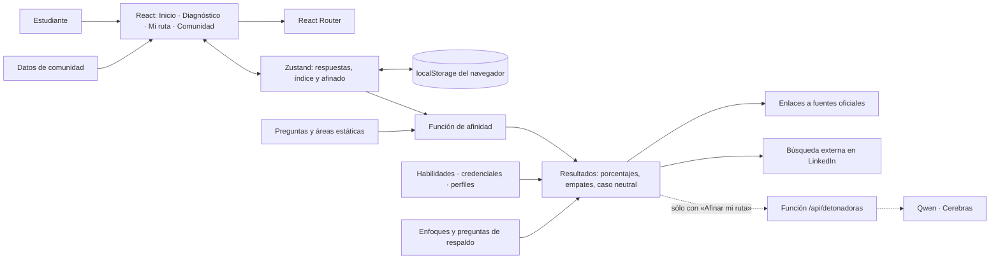

*Arquitectura actual. El sitio es estático: no hay cuentas ni base de datos, y las respuestas se quedan en el navegador. Sólo salen en dos casos que el estudiante dispara: los dos términos que escribe en la búsqueda de LinkedIn, y las 50 respuestas numéricas cuando pulsa «Afinar mi ruta» (línea punteada). Sin esa función, el afinado usa preguntas de respaldo escritas a mano.*

- **Frontend:** **React 19** y **Vite**, estilizado con **Tailwind CSS v4** sobre un sistema editorial propio. Opera del lado del cliente; sin librerías de animación —el contenido nunca espera a una animación para aparecer—.
- **Gestión de datos locales:** preguntas, áreas, ruta de habilidades, credenciales, perfiles profesionales, enfoques y comunidad son módulos JavaScript estáticos en `src/data/`. El estado del cuestionario lo administra **Zustand** y persiste en `localStorage` (clave `potropath-quiz`), saneado al rehidratar.
- **Procesamiento:** cada respuesta (1–5) suma sólo a su área; el total se expresa como porcentaje del máximo de 50 puntos. Con el diagnóstico completo la escala va de 20% a 100% y 60% es el punto neutral. Los empates se reconocen y responder "Neutral" a todo no produce un ganador. Las recomendaciones son asociaciones estáticas área → habilidades → credenciales → perfiles: **la IA no recomienda nada ni predice empleabilidad.** La función es pura (`src/lib/affinity.js`) y está cubierta por pruebas.
- **Afinado con IA (función opcional):** una sola función de Vercel, `POST /api/detonadoras`, guarda la llave de Cerebras y arma el prompt. Sólo se llama cuando el estudiante pulsa "Afinar mi ruta", después de leer en pantalla qué se envía: exclusivamente las 50 respuestas numéricas, sin ningún dato que lo identifique. Qwen 3.8 27B (`qwen-3.8-27b`, con razonamiento de esfuerzo bajo y salida validada contra un esquema JSON) redacta dos preguntas; si la respuesta no pasa la validación y queda tiempo, se reintenta una vez sin razonamiento; cada opción queda atada a uno de los quince enfoques del catálogo, y la cuenta que elige el enfoque es determinista. Si el modelo falla, tarda más de 8 segundos o la función no existe, el sitio usa dos preguntas de respaldo escritas a mano y lo dice.
- **Calidad:** pruebas automatizadas (`npm test`), lint sin advertencias y verificación en navegador a 390 y 1440 px. Rendimiento medido con Lighthouse en [`docs/RENDIMIENTO.md`](docs/RENDIMIENTO.md).
- **Backend y base de datos (analíticas anónimas):** ⏳ *pendiente de decidir tras el piloto* — se contempla **Supabase** (PostgreSQL) o la infraestructura que defina la universidad, sólo para eventos agregados y sin perfiles de usuario. Ver [`docs/PLAN-INSTITUCIONAL.md`](docs/PLAN-INSTITUCIONAL.md).
- **Proyección institucional y escalabilidad:** al ser un sitio estático, puede alojarse en cualquier servidor web de la UAEMéx sin dependencias de ejecución; ahí el afinado funciona con las preguntas de respaldo. Llevar también la IA exige una función equivalente a `/api/detonadoras`, cuyo contrato está escrito para poder reimplementarse en PHP. Una migración a PHP y bases de datos locales sólo se justifica si un servicio de datos llega a ser necesario; el plan por etapas está en el documento institucional.

### 5. Validación y evidencia

| Pregunta | Dónde está la respuesta | Estado |
| --- | --- | --- |
| ¿Cómo está construido y cómo procesa? | [`docs/ARQUITECTURA.md`](docs/ARQUITECTURA.md) | ✅ Documentado y contrastado con el código |
| ¿Qué tan rápido carga? | [`docs/RENDIMIENTO.md`](docs/RENDIMIENTO.md) | ✅ Medido (laboratorio, condiciones declaradas) |
| ¿Lo entienden y les sirve a los estudiantes? | [`docs/PILOTO.md`](docs/PILOTO.md) | ⏳ Protocolo, instrumentos y metas listos; piloto sin ejecutar |
| ¿Cómo se adopta en la facultad? | [`docs/PLAN-INSTITUCIONAL.md`](docs/PLAN-INSTITUCIONAL.md) | ⏳ Plan por etapas; responsables por confirmar |
| ¿En qué se distingue de herramientas similares? | [`docs/COMPARATIVA.md`](docs/COMPARATIVA.md) | ✅ Matriz con fuentes y fecha |
| ¿Qué cambió en el rediseño y cómo se verificó? | [`docs/REDISENO.md`](docs/REDISENO.md) | ✅ Implementado y verificado |

**Ningún resultado del piloto se presenta como obtenido antes de ejecutarlo.** Los testimonios de Inicio aparecerán sólo con citas reales y autorización de cada participante.

---

## Referencia técnica

### Stack técnico

Las versiones exactas las fija `package-lock.json`; `npm ci` las reproduce tal cual.

| Capa                      | Tecnología                                          | Versión | Estado         |
| ------------------------- | --------------------------------------------------- | ------- | -------------- |
| UI / Frontend             | [React](https://react.dev/)                          | 19      | ✅ Configurado |
| Build tool                | [Vite](https://vite.dev/)                            | 8       | ✅ Configurado |
| Estilos                   | [Tailwind CSS](https://tailwindcss.com/)             | 4       | ✅ Configurado |
| Enrutamiento              | [React Router](https://reactrouter.com/)             | 7       | ✅ Configurado |
| Estado global             | [Zustand](https://zustand.docs.pmnd.rs/)             | 5       | ✅ Configurado |
| Linter                    | [oxlint](https://oxc.rs/docs/guide/usage/linter)     | 1       | ✅ Configurado |
| Pruebas                   | Runner nativo de Node (`node --test`)                | 20+     | ✅ Configurado |
| Función del afinado       | [Vercel Functions](https://vercel.com/docs/functions) | —       | ✅ Configurado |
| Modelo de las detonadoras | [Qwen 3.8 27B en Cerebras](https://inference-docs.cerebras.ai/models/qwen-3.8-27b) | 3.8 27B | ✅ Configurado |
| Backend / DB analítica    | [Supabase](https://supabase.com/)                    | —       | ⏳ Pendiente   |

Tailwind v4 se configura **en CSS** (bloque `@theme` en `src/index.css`): no existe `tailwind.config.js` y no debe crearse.

### Puesta en marcha detallada

#### Requisitos

| Requisito | Versión | Por qué |
| --- | --- | --- |
| [Node.js](https://nodejs.org/) | `^20.19.0` o `>=22.12.0` | Lo exigen Vite 8, `@vitejs/plugin-react` y oxlint |
| npm | 10 o superior (viene con Node) | El repositorio usa `package-lock.json` v3 |
| Git | cualquiera reciente | Sólo para clonar |

```bash
node -v   # debe imprimir v20.19+ o v22.12+
npm -v
```

#### Instalación y arranque

```bash
git clone https://github.com/RogelioZu/PotroHub.git
cd PotroHub

npm ci            # instalación reproducible desde package-lock.json (recomendada)
# npm install     # alternativa: resuelve el rango de versiones de package.json

npm run dev       # http://localhost:5173
```

`npm run dev` deja el servidor en marcha con recarga en caliente y se detiene con `Ctrl+C`. Si el puerto 5173 está ocupado, Vite toma el siguiente libre e imprime la dirección real en la terminal: hay que abrir esa, no la de este documento.

#### Probar el afinado con Qwen

Hacen falta una llave de [Cerebras](https://cloud.cerebras.ai) —cuenta prepagada, con la recarga automática apagada— y la CLI de Vercel:

```bash
cp .env.example .env   # y llenar CEREBRAS_API_KEY
npx vercel dev         # http://localhost:3000, sitio y función juntos
```

Ninguna variable lleva el prefijo `VITE_`: Vite mete al bundle del navegador toda variable que empiece así, y la llave no puede llegar ahí. `.env` está en `.gitignore`.

#### Ver el build de producción

```bash
npm run build     # genera dist/ (no se versiona, está en .gitignore)
npm run preview   # sirve dist/ en http://localhost:4173
```

#### Comandos disponibles

| Comando | Qué hace |
| --- | --- |
| `npm run dev` | Servidor de desarrollo de Vite con recarga en caliente (`localhost:5173`) |
| `npm run build` | Build de producción en `dist/` |
| `npm run preview` | Sirve el build ya generado (`localhost:4173`), para revisarlo tal como se publicaría |
| `npm run lint` | oxlint sobre todo el repositorio, con las reglas de `.oxlintrc.json` |
| `npm test` | Pruebas de afinidad, integridad de datos profesionales, búsqueda y detonadoras (`tests/`) |
| `npx vercel dev` | El sitio más la función `/api/detonadoras`, con las variables de `.env` (`localhost:3000`) |
| `npm run eval:detonadoras` | Corre diez perfiles sintéticos contra Qwen e imprime las preguntas, para elegir el modelo y el esfuerzo de razonamiento leyendo. Gasta saldo real. `QWEN_EVAL_EFFORTS=none,low,medium` compara esfuerzos; `QWEN_EVAL_MODELS`, modelos |

#### Casos frecuentes

```bash
npm run dev -- --port 3000     # el puerto 5173 está ocupado
npm run dev -- --host          # abrir el sitio desde otro dispositivo de la misma red (teléfono)
rm -rf node_modules && npm ci  # instalación en un estado raro
```

Probar en un teléfono real vale la pena: el teléfono con red de campus mala es un caso de uso primario del producto, no un respaldo.

#### Verificación de un cambio

```bash
npm run lint      # sin errores ni advertencias
npm test          # todas las pruebas en verde
npm run build     # el build pasa
```

…y **mirar la página** en los dos anchos que importan, 390px (teléfono) y 1440px (laptop), recorriendo el flujo completo: Inicio → Diagnóstico → Mi ruta → Comunidad. `AGENTS.md` documenta el resto de la rutina, incluido el detector de anti-patrones de interfaz. Si el cambio altera lo que se ve en [Cómo se usa](#cómo-se-usa), las capturas de `docs/capturas/` se vuelven a tomar en esos mismos dos anchos.

### Rutas de la aplicación

| Ruta | Vista | Qué hace |
| --- | --- | --- |
| `/` | Inicio | Presentación y entrada al diagnóstico |
| `/quiz` | Diagnóstico | Las 50 preguntas, una por pantalla, con progreso reanudable |
| `/resultados` | Mi ruta | Afinidad en las cinco áreas (con empates), el afinado opcional a uno de los tres enfoques del área, y por cualquier área: habilidades por etapas, credenciales comparables, perfiles profesionales y búsqueda en LinkedIn |
| `/comunidad` | Comunidad | Directorio por especialidad (`?area=`), Rama Estudiantil IEEE UAEMéx, galería de experiencias y agenda |
| cualquier otra | 404 | Página de no encontrado |

Además, `POST /api/detonadoras` es la función del afinado. Su contrato está escrito en la cabecera de `api/detonadoras.js`, pensado para que un reemplazo en PHP pueda cumplirlo tal cual.

### Estructura del repositorio

```
src/
  main.jsx · App.jsx        Entrada y rutas: / · /quiz · /resultados · /comunidad · *
  index.css                 Tokens de Tailwind v4 y sistema editorial
  data/                     Contenido estático: preguntas, áreas, ruta, credenciales,
                            perfiles, comunidad, testimonios (vacío hasta el piloto),
                            los 15 enfoques y las preguntas detonadoras de respaldo
  store/quizStore.js        Zustand persistido en localStorage (clave `potropath-quiz`)
  lib/                      Afinidad y detonadoras (funciones puras), búsqueda LinkedIn,
                            formato y título
  components/               layout/ · results/ · home/ · community/ · ui/ · motion/
  pages/                    Home, Quiz, Results, Community, NotFound
api/                        La función de Vercel del afinado y su conversación con Qwen
scripts/                    Evaluación manual de las preguntas detonadoras
tests/                      Pruebas con `node --test`
docs/                       Arquitectura, rendimiento, piloto, plan institucional,
                            comparativa y bitácora del rediseño
  capturas/                 Capturas de este README (build de producción, 1440 y 390 px)
public/images/              Activos publicados; sus README documentan procedencia
assets-src/                 Masters sin comprimir; fuera de public/, no entran al build
dist/                       Salida de `npm run build` (ignorada por Git)
```

### Documentación del proyecto

El repositorio se documenta a sí mismo en cuatro archivos, cada uno con una autoridad distinta:

| Archivo | Qué manda |
| --- | --- |
| `README.md` | Este archivo: qué es y cómo se usa, memoria descriptiva académica y puesta en marcha |
| `PRODUCT.md` | Verdad de producto: usuarios, propósito, alcance, principios y **qué no existe y no puede inventarse** |
| `DESIGN.md` | El mundo visual comprometido: paleta, tipografía, layout, componentes, movimiento y sus Reglas Nombradas |
| `AGENTS.md` | Convenciones de código y guía de trabajo para quien (o lo que) edite el repositorio. `CLAUDE.md` sólo lo importa, para que Claude Code lo lea |

En decisiones visuales manda `DESIGN.md`; en verdad de producto y voz manda `PRODUCT.md`. `.impeccable/design.json` es el sidecar de `DESIGN.md` con los valores exactos de tokens y componentes.

---

## Estado del proyecto

**Real y utilizable hoy:** el banco de 50 preguntas y su escala; 25 habilidades con entregables, 10 credenciales y 5 perfiles profesionales con fuente y fecha de revisión; el catálogo de quince enfoques con su primer paso y las preguntas de respaldo; seis fotografías verificadas de estudiantes de la facultad; cinco canales de Microsoft Teams, uno por especialidad; el vitral y la mascota; y el sitio completo navegable de punta a punta, con pruebas automatizadas.

**Pendiente, declarado como pendiente en la propia interfaz** — ninguno de estos se simula como si ya existiera:

- La prueba piloto con estudiantes y, después de ella, los testimonios autorizados (protocolo en `docs/PILOTO.md`).
- La agenda real de eventos de la Rama IEEE y la confirmación de sus capítulos activos.
- La estadística de titulación de la UAEMéx que sustentará el planteamiento.
- El backend de analíticas anónimas en Supabase.
- Qué retiene Cerebras de las llamadas del afinado y en qué región las procesa: sus [políticas](https://www.cerebras.ai/policies) no lo dicen de forma verificable todavía.

**Ningún estudiante ha usado todavía el producto fuera de las pruebas de desarrollo.** No hay testimonios, conteos de usuarios, cifras de adopción, convenios ni aprobación institucional, y nada de eso debe aparecer como contenido del sitio.
