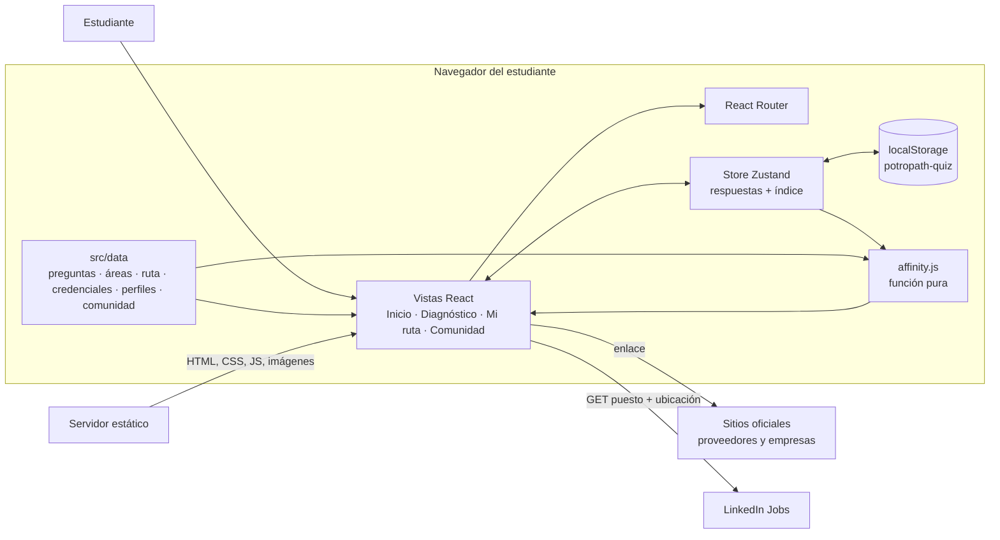
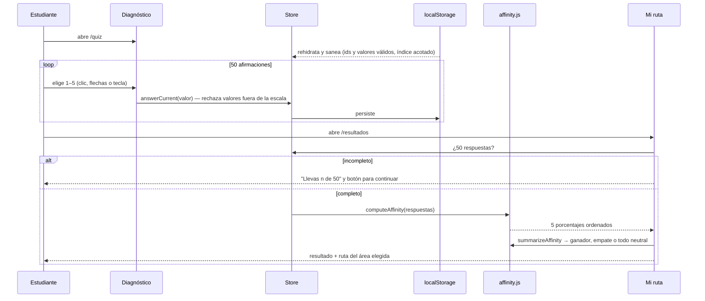
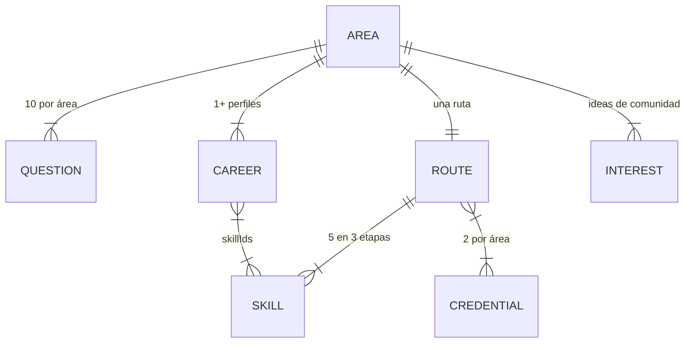
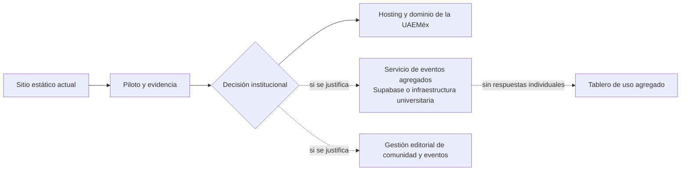

# Arquitectura y procesamiento de PotroPath

Estado: describe el código de la rama `rediseno/guia-editorial` al 8 de octubre de 2026. La sección
*Arquitectura futura* es una propuesta, no algo implementado.

## 1. Vista general

PotroPath es una aplicación web de una sola página (SPA) que corre por completo en el navegador del
estudiante. No hay servidor de aplicación, cuentas ni base de datos. El sitio compilado son
archivos estáticos (HTML, CSS, JS e imágenes) que cualquier servidor web puede publicar.



| Capa | Tecnología | Responsabilidad |
|---|---|---|
| Presentación | React 19, Tailwind CSS v4 | Vistas, sistema editorial, accesibilidad |
| Navegación | React Router 7 | Rutas `/`, `/quiz`, `/resultados`, `/comunidad`, 404; foco y anclas al cambiar de vista |
| Estado | Zustand 5 + `persist` | Respuestas e índice de pregunta; saneamiento al rehidratar |
| Persistencia | `localStorage` | Sobrevive al cierre de pestaña; nunca sale del navegador |
| Lógica | `src/lib/affinity.js` | Cálculo de afinidad, empates y caso neutral (sin React, probado con Node) |
| Contenido | `src/data/*.js` | Datos estáticos versionados con el código, con fuente y fecha de revisión |
| Build | Vite 8 | Empaquetado y optimización; salida en `dist/` |
| Calidad | oxlint, `node --test` | Lint y 13 pruebas automatizadas |

### Qué datos salen del navegador

| Dato | ¿Sale? | Hacia dónde |
|---|---|---|
| Respuestas del diagnóstico | **No** | Sólo `localStorage` |
| Porcentajes de afinidad | **No** | Se calculan en memoria |
| Puesto y ubicación escritos en el buscador | Sí, al pulsar "Buscar en LinkedIn" | `linkedin.com/jobs/search` como parámetros GET |
| Navegación a fuentes oficiales | Sí, al pulsar el enlace | El sitio del proveedor o la empresa |

El sitio carga además la tipografía DM Sans desde Google Fonts. No hay analítica ni cookies propias.

## 2. Flujo de procesamiento



1. **Rehidratación.** Al cargar, el store lee `potropath-quiz` y descarta ids de pregunta
   desconocidos y valores fuera de 1–5; acota el índice a 0–49. Una sesión vieja o editada a mano no
   puede romper la vista.
2. **Respuesta.** Cada selección válida se guarda de inmediato. Retroceder permite cambiar
   respuestas. El progreso visible cuenta **respuestas guardadas**, no la posición.
3. **Completitud.** Resultados exige las 50 respuestas. Con una sesión parcial los porcentajes
   pueden caer debajo de 20% y se leerían como un perfil, así que no se muestran.
4. **Cálculo.** Ver la sección 3.
5. **Interpretación honesta.** `summarizeAffinity` devuelve todas las áreas empatadas en el primer
   lugar y si todas las respuestas fueron "Neutral". La vista usa eso para el titular y el título
   del navegador.
6. **Recomendación.** Es una **asociación estática**: el área elegida apunta a sus habilidades
   (`roadmap.js`), sus dos credenciales (`credentials.js`) y su perfil profesional (`careers.js`).
   No hay modelo de IA, ranking aprendido ni predicción de empleabilidad.
7. **Exploración.** El estudiante puede abrir cualquiera de las cinco rutas. Cambiar de ruta no
   recalcula ni modifica respuestas.
8. **Salidas externas.** Comunidad recibe el área por URL (`/comunidad?area=nube#especialidades`).
   LinkedIn recibe sólo puesto y ubicación.

## 3. Fórmula de afinidad

Para cada área *a* con diez afirmaciones y respuestas *r* ∈ {1, 2, 3, 4, 5}:

```
puntaje(a)    = Σ r  de las diez afirmaciones de a        (10 a 50)
porcentaje(a) = redondear(puntaje(a) / 50 × 100)          (20 a 100 con el diagnóstico completo)
```

| Respuestas en un área | Puntaje | Porcentaje |
|---|---|---|
| Diez "Totalmente en desacuerdo" (1) | 10 | 20% (piso) |
| Diez "Neutral" (3) | 30 | 60% (punto medio) |
| Diez "Totalmente de acuerdo" (5) | 50 | 100% |

**Ejemplo.** Una estudiante responde en Ciberseguridad 5, 4, 5, 3, 4, 5, 4, 4, 3, 5 (suma 42) y en
Cloud Computing 3, 3, 4, 2, 3, 4, 3, 3, 4, 3 (suma 32). Ciberseguridad = 42 / 50 = **84%**; Cloud =
32 / 50 = **64%**. Cada área se mide por separado: los cinco porcentajes no suman 100 y no son
probabilidades.

**Propiedades verificadas por `tests/affinity.test.js`:** 50 ids únicos y diez por área; escala
20–100; todo neutral produce cinco áreas en 60% y se reconoce como empate total; un ganador único no
altera a las demás áreas; un empate parcial devuelve todas las áreas empatadas; los valores
inválidos no suman.

**Límites.** El instrumento mide interés declarado mediante afirmaciones tipo Likert. No ha sido
validado psicométricamente (confiabilidad, validez de constructo) y no mide aptitud ni dominio. Si
el banco de preguntas deja de tener la misma cantidad por área, el denominador debe calcularse por
área.

## 4. Modelo de contenido



- Cada credencial y perfil lleva `sourceUrl` y `reviewedAt`. `tests/professional-route.test.js`
  falla si un perfil apunta a una habilidad inexistente, si falta una fuente o si una foto de la
  galería no tiene pie o texto alternativo.
- Lo pendiente es dato explícito: `TEAMS_JOIN_URL = null`, `EVENTS = []`, `TESTIMONIALS = []`. La
  interfaz muestra un estado honesto en vez de un control que no hace nada.

## 5. Decisiones de arquitectura

| Decisión | Alternativa descartada | Por qué |
|---|---|---|
| Todo en el cliente, sin registro | Backend con cuentas | Pedir datos antes de dar valor reduce la participación (PRODUCT.md, principio 1) y obliga a gestionar datos personales |
| `localStorage` para el avance | Sesión en servidor | 50 preguntas en un teléfono entre clases: la sesión debe sobrevivir al cierre sin cuenta |
| Contenido como módulos JS | CMS | Volumen pequeño, cambios raros y revisables en Git; las pruebas validan referencias |
| Función de afinidad pura | Cálculo dentro del componente | Se prueba sin navegador y su comportamiento queda documentado por pruebas |
| Sin librerías de animación | GSAP + ScrollSmoother + Matter.js | El contenido dependía de animaciones para aparecer; quitar 3 dependencias redujo el JS de entrada de 141.9 a 96.0 kB gzip |
| Búsqueda en LinkedIn por GET | API de empleos o scraping | No requiere credenciales, no copia datos de terceros y funciona sin JavaScript |

## 6. Arquitectura futura (propuesta, no implementada)

Sólo se añade un servicio si el piloto demuestra una necesidad y existe un responsable de datos.



Eventos mínimos que podrían registrarse, con consentimiento y retención definidos antes de
instrumentar: diagnóstico iniciado, diagnóstico completado, ruta explorada, salida a recurso
externo. **Nunca** respuestas individuales, texto libre ni nombres. Si se instrumenta, debe
actualizarse la afirmación de que la información permanece únicamente en el navegador, en el pie
del sitio y en este documento.

Una futura API necesitaría pruebas propias de concurrencia, errores y recuperación; el rendimiento
del sitio estático (ver `RENDIMIENTO.md`) no dice nada sobre ella.
