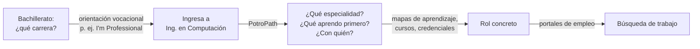

# Comparativa con herramientas similares

Revisión: 8 de octubre de 2026. Compara **características declaradas públicamente** por cada
alternativa, con su fuente. No es una evaluación de calidad ni afirma que PotroPath sea superior:
esa conclusión necesitaría una prueba con usuarios que todavía no se ha hecho (ver `PILOTO.md`).

## 1. El hueco que ocupa PotroPath

La orientación vocacional suele terminar cuando el estudiante elige carrera. Los mapas de
aprendizaje empiezan cuando ya sabe qué rol quiere. Entre los dos queda un tramo sin atender: el
estudiante que **ya está en Ingeniería en Computación** y todavía no sabe hacia qué especialidad
crecer, qué aprender primero ni con quién de su facultad hacerlo.

## 2. Matriz

| Criterio | Orientación vocacional preuniversitaria (*I'm Professional*, UAEMéx) | Mapas de aprendizaje (roadmap.sh) | Portales de credenciales (Google, AWS, Microsoft, Coursera) | Portales de empleo (LinkedIn Jobs) | **PotroPath** |
|---|---|---|---|---|---|
| Público | Bachillerato eligiendo carrera | Desarrolladores de cualquier lugar | Cualquier persona | Cualquier persona | Estudiantes de Ing. en Computación, FI UAEMéx |
| Pregunta que responde | ¿Qué carrera estudio? | ¿Qué aprendo para el rol X? | ¿Cómo acredito X? | ¿Qué vacantes hay? | ¿Hacia qué especialidad crezco, qué aprendo primero y con quién? |
| Diagnóstico de intereses | Sí: pruebas vocacionales, entrevistas | No | No | No | Sí: 50 afirmaciones, 5 especialidades |
| Ruta de aprendizaje | No declarada | Sí: 31 por rol y 59 por habilidad | Por programa | No | Sí: 3 etapas y un entregable por habilidad |
| Compara credenciales | No declarada | No | Sólo las propias | No | Sí: dos programas de distintos proveedores por las mismas dimensiones |
| Perfiles laborales | Análisis del mercado laboral | No | No | Sí, en vivo | Ejemplos documentados con requisitos y fuente; enlaza a LinkedIn |
| Comunidad local | No declarada | Discord global | No | Red profesional global | Rama IEEE UAEMéx y espacios por especialidad (acceso de Teams pendiente) |
| Registro para usarlo | No declarado | No para ver; sí para seguir avance | Sí para cursar | Puede pedir sesión | No |
| Idioma | Español | Inglés | Variable | Variable | Español |
| Plataforma | App iOS y Android | Web | Web | Web y app | Web, pensada para teléfono |
| Evidencia de validación publicada | Primer lugar, Feria Emprende-Dual 2026 | Uso masivo declarado | — | — | Pendiente: piloto propuesto |

**Fuentes**

- *I'm Professional*: [Comunicado 350, DGCSU UAEMéx, 30 de junio de 2026](https://dgcsu.uaemex.mx/media/attachments/2026/06/29/comunicado350.docx.pdf) — "una plataforma que acompaña a jóvenes de bachillerato en la elección de su carrera"; pruebas vocacionales, entrevistas, asesoría socioemocional, proyectos de vida y análisis del mercado laboral; iOS y Android.
- roadmap.sh: [página principal](https://roadmap.sh/), consultada el 8 de octubre de 2026 — 31 rutas por rol, 59 por habilidad, ver sin cuenta, cuenta para registrar avance, comunidad en Discord.
- Credenciales: las fichas oficiales enlazadas en `src/data/credentials.js`.
- LinkedIn: [búsqueda pública de empleos](https://www.linkedin.com/jobs/search/).

"No declarada" significa que la fuente consultada no lo menciona, no que no exista.

## 3. Lectura

- **Complementariedad, no competencia.** *I'm Professional* —desarrollada en una preparatoria de
  la propia UAEMéx— acompaña la elección de carrera. PotroPath empieza donde esa decisión termina.
  Juntas cubrirían el trayecto completo dentro de la universidad; vale la pena explorar enlazarlas.
- **PotroPath no sustituye a roadmap.sh ni a los proveedores:** los usa como destino. Su aporte es
  el paso previo (cuál ruta) y el contexto (en español, con la facultad y su comunidad).
- **Donde PotroPath es más débil hoy:** no tiene validación con usuarios, su comunidad local aún no
  tiene acceso activo y su cuestionario no está validado psicométricamente. Esas tres cosas son el
  objetivo del piloto y del plan institucional.

## 4. Cómo actualizar esta comparativa

Repetir la consulta de cada fuente cada semestre, cambiar la fecha de revisión de arriba y anotar
qué cambió. Si se agrega una alternativa, citar su página oficial y sólo características que la
fuente declare.
